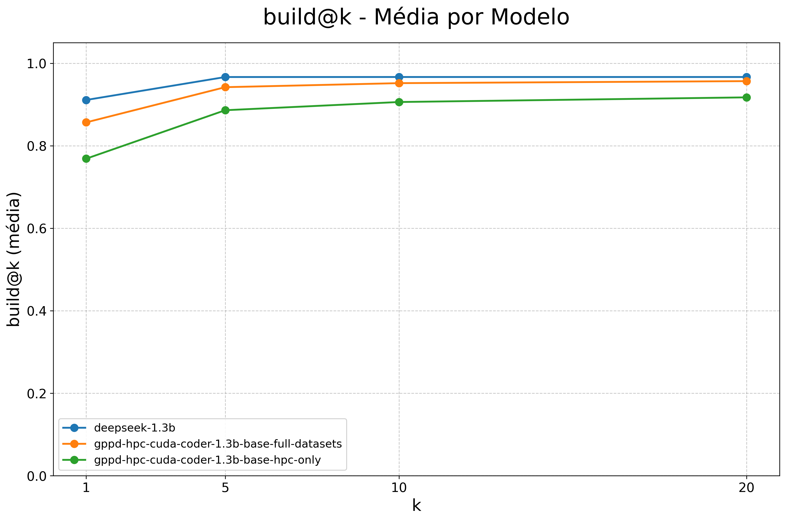
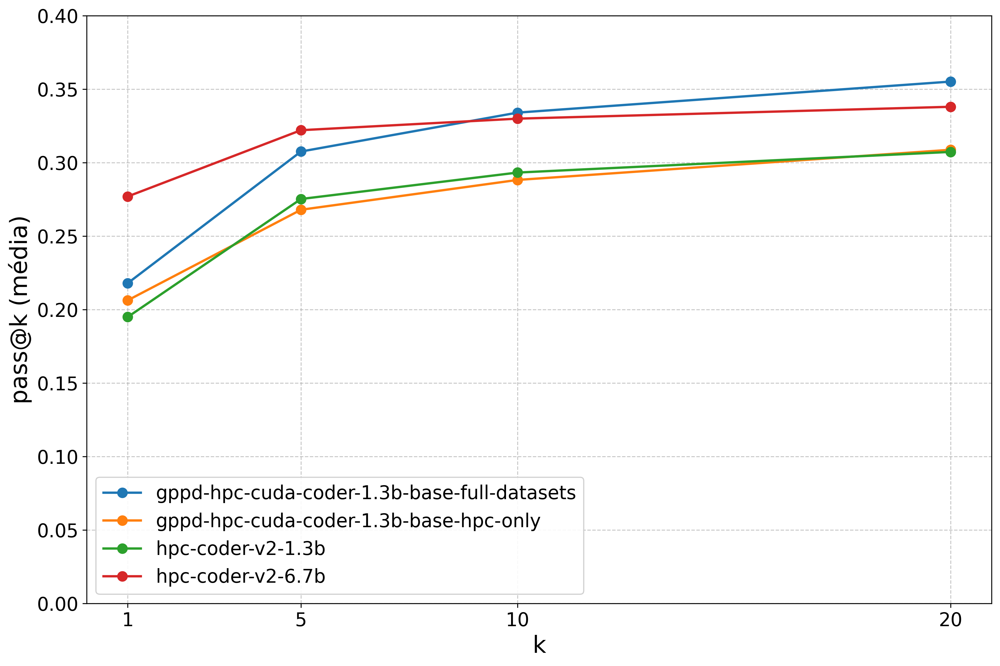
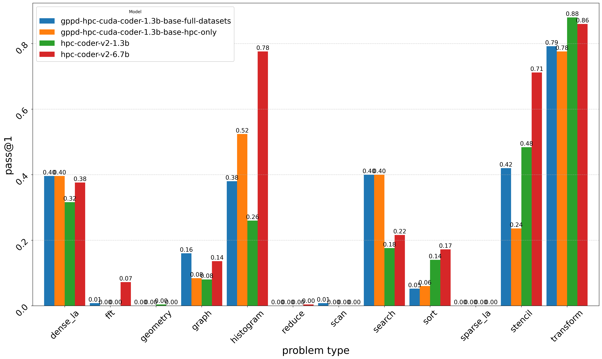

# Resultados obtidos

[Voltar ao README](../readme.md) · [Metodologia](metodologia.md)

Os números abaixo foram recalculados a partir dos CSVs existentes, sem novo treinamento ou execução do benchmark. As figuras e a discussão correspondem ao capítulo 5 da [monografia](../TCC-GPPD-HPC-Coder.pdf).

## Fonte e critério de leitura

A tabela consolidada [metrics/all-metrics.csv](../metrics/all-metrics.csv) contém 60 linhas de dados: cinco modelos por 12 categorias. Os identificadores nesse arquivo têm o sufixo `[v2]`, aqui preservado como parte da identificação original, sem atribuir a ele uma configuração não documentada.

Os resultados de compilação e correção coincidem com os recortes `build@k-*.csv` e `pass@k-*.csv`. Calculamos a média aritmética das categorias para cada modelo e arredondamos apenas a apresentação para duas casas decimais. Nos recortes, linhas separadoras sem modelo devem ser descartadas. Os valores de build e pass estão na escala de 0 a 1 nos arquivos e aparecem em porcentagem nas tabelas.

## Compilação

| Modelo | build@1 | build@5 | build@10 | build@20 |
| --- | ---: | ---: | ---: | ---: |
| DeepSeek-Coder base 1,3B | 91,10% | 96,66% | 96,67% | 96,67% |
| GPPD Full 1,3B | 85,67% | 94,20% | 95,18% | 95,66% |
| GPPD HPC-only 1,3B | 76,87% | 88,61% | 90,60% | 91,73% |
| HPC-Coder-V2 1,3B | 54,70% | 76,48% | 81,84% | 85,55% |
| HPC-Coder-V2 6,7B | 57,33% | 71,58% | 76,55% | 79,79% |

O modelo base apresenta a maior média de compilação em todos os valores de k registrados. Ambos os refinamentos GPPD superam os dois HPC-Coder-V2 nessa métrica. Portanto, o ganho do refinamento frente ao modelo base deve ser avaliado pela correção, e não por um aumento da taxa de compilação.

## Correção funcional

| Modelo | pass@1 | pass@5 | pass@10 | pass@20 |
| --- | ---: | ---: | ---: | ---: |
| DeepSeek-Coder base 1,3B | 18,27% | 29,29% | 33,32% | 36,33% |
| GPPD Full 1,3B | 21,80% | 30,76% | 33,40% | 35,52% |
| GPPD HPC-only 1,3B | 20,63% | 26,79% | 28,82% | 30,88% |
| HPC-Coder-V2 1,3B | 19,50% | 27,53% | 29,33% | 30,73% |
| HPC-Coder-V2 6,7B | 27,70% | 32,21% | 32,99% | 33,80% |

O GPPD Full melhora `pass@1` em **3,53 pontos percentuais** frente ao modelo base. O ganho do HPC-only é de **2,37 pontos percentuais**. O Full supera o HPC-only em todos os valores de k da tabela, mas o efeito dos dados adicionais varia por categoria.

O HPC-Coder-V2-6.7B lidera em k = 1 e k = 5. Em k = 10 e k = 20, o Full supera esse modelo, apesar de ter cerca de 5,15 vezes menos parâmetros. Em k = 20, o modelo base alcança a maior média dos cinco. Essas diferenças são descritivas: o acervo não fornece intervalos de confiança para afirmar significância estatística.

## Diferenças entre tipos de problema

Valores de `pass@1` extraídos de `all-metrics.csv`:

| Categoria | GPPD Full | GPPD HPC-only | HPC-Coder-V2 1,3B | HPC-Coder-V2 6,7B |
| --- | ---: | ---: | ---: | ---: |
| histogram | 38,00% | 52,40% | 26,00% | 77,60% |
| search | 40,00% | 40,00% | 17,60% | 21,60% |
| stencil | 42,00% | 23,60% | 48,40% | 71,20% |

Os refinamentos GPPD se destacam em `search` frente aos HPC-Coder-V2. O HPC-only obtém maior correção em `histogram` que o Full; em `stencil`, a relação se inverte. A discussão do TCC também destaca dificuldades em `geometry`, `reduce`, `scan` e `sparse_la`, mesmo quando a compilação tem sucesso.

## Recursos computacionais e desempenho de execução

O TCC relata o refinamento GPPD em uma RTX 4090 de 24 GB, com aproximadamente 13 horas para Full. Isso documenta a viabilidade do experimento nesse hardware. Não há medições versionadas de energia, custo financeiro ou tempo de treinamento comparável dos demais modelos para quantificar economia.

Também há colunas e figuras de `speedup`, `speedup_max`, `efficiency` e `efficiency_max`. Elas devem ser consultadas como resultados exportados, com estas limitações:

- Os tempos individuais, tamanhos de problema usados e configurações completas do benchmark não estão no repositório.
- Há valores de grande magnitude, como `speedup@1` de aproximadamente 256 mil para `dense_la` do modelo base, que exigem conferência dos dados brutos e da definição da métrica antes de uma conclusão de aceleração.
- Os CSVs `speedup@1-without-stencil.csv` e `efficiency@1-without-stencil.csv` ainda contêm linhas `stencil`. O nome do arquivo não deve ser usado como garantia do filtro.

Por isso, a síntese principal se concentra em compilação e correção. A seção 5.3 do TCC discute recursos de treinamento; esse aspecto é distinto da velocidade dos kernels gerados.

## Alcance das conclusões

A especialização melhora a correção na primeira amostra frente ao modelo base e permite competir com modelos maiores em determinados recortes. Os resultados não sustentam superioridade em todas as métricas ou categorias. Sem pesos, saídas brutas, sementes e versões originais do ambiente, é possível analisar os agregados disponíveis, mas não auditar integralmente cada execução. Os próximos registros necessários estão no [guia de reprodução](reproducibilidade.md).
