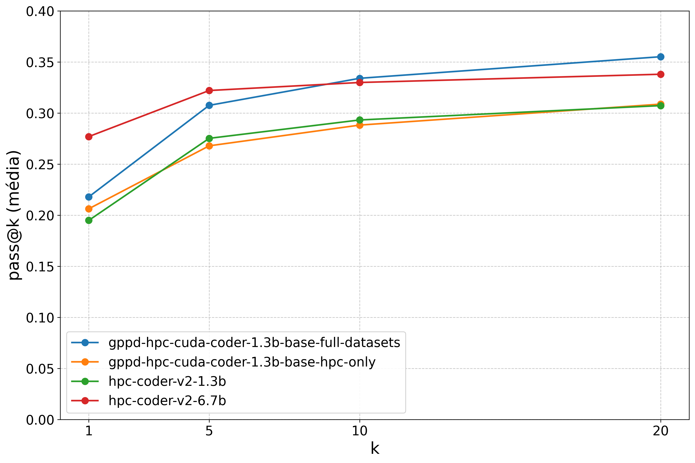

# GPPD-HPC-Coder

**Especialização de um Small Language Model para geração de código paralelo em CUDA.**

Repositório do Trabalho de Conclusão de Curso **Aprimoramento de SLM para Geração de Código Paralelo em Computação de Alto Desempenho**, de Guilherme Domingos Santana, apresentado no curso de Engenharia de Computação da Universidade Federal do Rio Grande do Sul (UFRGS), sob orientação do Prof. Dr. Arthur Lorenzon, em 2026.

O trabalho investiga se um modelo de 1,3 bilhão de parâmetros, refinado para CUDA, pode competir com modelos maiores em tarefas de programação paralela. O estudo utiliza DeepSeek-Coder, fine-tuning supervisionado com LoRA e avaliação no recorte CUDA do ParEval.

## Por onde começar

| Material | Conteúdo |
| --- | --- |
| [Monografia](TG2_rascunho.pdf) | Fundamentação, metodologia e discussão. O arquivo disponível mantém o nome original de rascunho. |
| [Metodologia](docs/metodologia.md) | Ambiente experimental, datasets, modelos e protocolo de avaliação. |
| [Resultados](docs/resultados.md) | Tabelas, gráficos, interpretação e limitações dos dados disponíveis. |
| [Reprodução dos experimentos](docs/reproducibilidade.md) | Treinamento, inferência, fluxo do ParEval e artefatos necessários. |
| [Organização do acervo](docs/organizacao.md) | Mapa dos arquivos, relação com as figuras do TCC e próximos passos. |
| [Início rápido](QUICKSTART.md) | Comandos básicos para usar o código. |
| [Guia do carregador de datasets](DATASET_LOADER_GUIDE.md) | Referência detalhada do módulo de dados. |

## Visão geral da pesquisa

1. Selecionar os exemplos CUDA do dataset HPC-INSTRUCT.
2. Refinar o `deepseek-ai/deepseek-coder-1.3b-base` em duas configurações: **HPC-only**, somente com esses exemplos, e **Full**, acrescentando Evol-Instruct-Code e Magicoder-OSS-Instruct, sem filtro CUDA nos datasets adicionais.
3. Gerar soluções para tarefas CUDA do ParEval e avaliar compilação e correção funcional.
4. Comparar os modelos refinados ao DeepSeek-Coder base e aos HPC-Coder-V2 de 1,3B e 6,7B parâmetros.

O refinamento foi realizado na infraestrutura do GPPD/UFRGS, em uma NVIDIA RTX 4090 de 24 GB. A monografia relata aproximadamente 13 horas de treinamento e 167.756 instruções para a configuração Full. Esses registros históricos não foram reexecutados nesta organização do repositório.

## Principais resultados

Médias aritméticas das **12 categorias** presentes em [metrics/all-metrics.csv](metrics/all-metrics.csv), em porcentagem. `build@k` estima a obtenção de ao menos uma solução compilável em k amostras; `pass@k`, de ao menos uma solução funcionalmente correta. Essas métricas não medem velocidade.

| Modelo | Parâmetros | build@1 | pass@1 | pass@5 | pass@10 | pass@20 |
| --- | --- | ---: | ---: | ---: | ---: | ---: |
| DeepSeek-Coder base | 1,3B | 91,10% | 18,27% | 29,29% | 33,32% | 36,33% |
| GPPD Full | 1,3B | 85,67% | 21,80% | 30,76% | 33,40% | 35,52% |
| GPPD HPC-only | 1,3B | 76,87% | 20,63% | 26,79% | 28,82% | 30,88% |
| HPC-Coder-V2 | 1,3B | 54,70% | 19,50% | 27,53% | 29,33% | 30,73% |
| HPC-Coder-V2 | 6,7B | 57,33% | 27,70% | 32,21% | 32,99% | 33,80% |

- O GPPD Full melhora `pass@1` em **3,53 pontos percentuais** em relação ao modelo base, embora compile menos soluções.
- Os dois modelos GPPD superam os HPC-Coder-V2 em `build@1` médio.
- O HPC-Coder-V2-6.7B lidera em `pass@1` e `pass@5`; o GPPD Full apresenta médias maiores em `pass@10` e `pass@20` nessa comparação. O modelo base tem o maior `pass@20` entre os cinco.
- Os benefícios variam entre categorias. Compilar código não garante correção funcional, e os resultados não demonstram superioridade geral em todas as tarefas.



Veja a [análise completa](docs/resultados.md) para resultados por categoria e os cuidados ao interpretar speedup e eficiência.

## Estrutura do repositório

```text
.
├── docs/                        # Metodologia, resultados e reprodução
├── finetune_with_args.py         # CLI de treinamento supervisionado com LoRA
├── dataset_loader.py             # Download, filtragem e formatação dos dados
├── utils/                       # Inferência, geração de respostas e diagnósticos
├── prompts/                     # 60 prompts CUDA em 12 categorias
├── metrics/                     # 13 CSVs de métricas e recortes
├── graphs/                      # Gráficos de build e pass usados na análise
├── Graficos*/                   # Coleções adicionais de figuras
├── requirements.txt             # Dependências Python, sem versões fixadas
└── TG2_rascunho.pdf              # Monografia disponível
```

## Executar localmente

Use um ambiente Python com PyTorch/CUDA compatíveis com a GPU. A instalação inclui `bitsandbytes` e `flash-attn`, que dependem do ambiente CUDA.

```bash
python3 -m venv venv
source venv/bin/activate
pip install -r requirements.txt
python3 utils/check_compatibility.py
```

Exemplo de refinamento com todos os datasets, usando o modelo base descrito no TCC:

```bash
python3 finetune_with_args.py \
  --model_name deepseek-ai/deepseek-coder-1.3b-base \
  --output_dir ./checkpoints/gppd-full \
  --save_dir ./finetuned-models/gppd-full \
  --log_file ./logs/gppd-full.log \
  --use_evol_instruct \
  --use_magicoder
```

Para HPC-only, omita as duas últimas flags. O código salva adaptadores LoRA e tokenizer; também tenta exportar um modelo mesclado. Consulte as [instruções e limites de reprodução](docs/reproducibilidade.md) antes de iniciar um novo experimento.

## Estado do acervo

Estão disponíveis o código de refinamento, os prompts, as métricas agregadas e as figuras. Os pesos dos modelos, logs originais, saídas individuais e configurações completas das execuções do ParEval não estão incluídos. O benchmark foi executado em um [repositório separado](https://github.com/gdsantana/ParEval), conforme a monografia.

A documentação registra diferenças entre o texto e o código atual, incluindo o uso de *instruction masking* e o parâmetro `--max_length`. Este acervo permite consultar e analisar os resultados, mas ainda não constitui uma reprodução integral dos experimentos originais.

## Autoria e referência

SANTANA, Guilherme Domingos. **Aprimoramento de SLM para Geração de Código Paralelo em Computação de Alto Desempenho**. Trabalho de Conclusão de Curso (Engenharia de Computação), Instituto de Informática, Universidade Federal do Rio Grande do Sul, Porto Alegre, 2026.

O estudo utiliza trabalhos e ferramentas de terceiros, discutidos nas referências da monografia. Não há arquivo de licença neste repositório; os modelos, datasets e o benchmark possuem seus próprios termos de uso.
